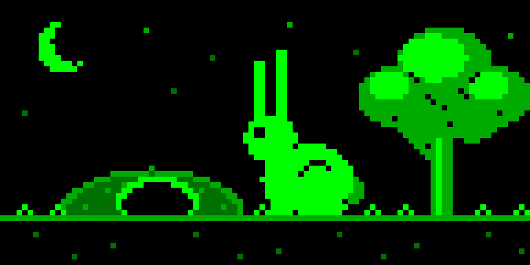

# Rabbit Hole for Even G2



Speak a topic. The backend fetches the Wikipedia article, Claude rewrites it as a
teaching breakdown, and the glasses play it one word at a time. Linked terms show
in [brackets]; open one and you are a level deeper.

```
 Quantum             |                          | +----------------+
 superposition       |                          | | The [double-   |
 6/11                |        interfere         | | slit           |
 200 wpm             |                          | | experiment] is |
 +--------+          |                          | | the classic    |
 | picture|          |                          | | case. A ...    |
 +--------+          |                          | +----------------+
```

Middle: the speed reader, one large word at the centre of the display. Right: the part
of the paragraph being read. Left: topic, position and speed, with the picture that goes
with the section underneath when the article has one.

If what you say is a name with several meanings ("mercury"), the glasses list them and
you pick one. Otherwise Claude chooses the article that best matches what you said.

When a topic opens, its main picture from Wikipedia (if it has a freely licensed one)
is shown for three seconds as a cover; a press skips it. The phone-side page shows the
same picture in colour, with a link to its author and licence.

## Controls (temple touchpads or R1 ring)

| Where   | Press            | Swipe up / down          | Double press            |
|---------|------------------|--------------------------|-------------------------|
| Home    | Speak a topic    | Topics you have read     | Exit                    |
| Reading | Play / pause     | Sentence back / forward  | Menu                    |
| Menu    | Choose           | Move                     | Close                   |

While reading, **hold** the ring (or a touchpad) and ask a question about what you are
reading, then let go. The answer plays one level deeper, like a link, and Back returns you
to where you were. The menu has the same thing as "Ask a question (speak)". On the
phone-side page, type `?` followed by the question.

The menu has Resume, Ask a question, Open a link, Slower, Faster, Back to the parent
topic, Topics you have read, New topic and Exit. It wraps around: swipe up on the first
item to land on the last. "Open a link" lists the linked words, those in the current
paragraph first; one you have already opened is listed as "Reread:" instead of "Open:".

Every topic you open is remembered on the phone (the last 50). The list is on the
glasses (swipe on the home screen, or from the menu) and on the phone-side page.

## Run it

Two parts: `server/` (holds the API keys) and `app/` (the Even Hub plugin).

```bash
# 1. backend
cd server
cp .env.example .env        # add ANTHROPIC_API_KEY, ELEVENLABS_API_KEY, APP_TOKEN
npm install
npm run dev                 # http://localhost:8787   (MOCK=1 npm run dev needs no keys)

# 2. app
cd ../app
cp .env.example .env.local  # VITE_API_BASE and VITE_API_TOKEN
npm install
npm run dev                 # http://localhost:5173
npm run simulate            # desktop simulator
```

On real glasses: `npx evenhub qr --url http://<your-computer-ip>:5173`, scan it in
the Even Realities app, and set `VITE_API_BASE` to `http://<your-computer-ip>:8787`
so the phone can reach the backend.

Skip the spoken step while developing: open `http://localhost:5173/?topic=Entropy`,
or type a topic on the phone-side page.

## Installing it in the Even app

The QR code only loads the app from your computer while the dev server runs. To keep it
on your phone, it has to go through Even Hub:

1. **The backend must be reachable from your phone.** The app does not hold the API
   keys; `server/` does. Either leave it running on a computer at home (the app then
   works only on that Wi-Fi), or deploy `server/` somewhere with https and set
   `APP_TOKEN`. Put its address in `VITE_API_BASE` in `app/.env.local` (it is built
   into the package) and in the `network` whitelist in `app/app.json`.
2. **Give the app its own ID.** Change `package_id` in `app/app.json` from
   `com.example.rabbithole` to one in your namespace (`npx evenhub self-check` shows it).
3. **Sign in, pack and upload** (from `app/`):

   ```bash
   npx evenhub login                      # once, in a terminal
   npm run pack                           # builds and writes out.ehpk
   npx evenhub create out.ehpk --name "Rabbit Hole" --tagline "Learn anything, one word at a time"
   npx evenhub promote 0.1.0 --to beta
   npx evenhub testers add you@example.com
   ```

   Accept the invitation email, and the beta build appears in your Even app. Later
   versions: bump `version` in `app.json`, `npm run pack`, `npx evenhub upload out.ehpk`,
   then `promote` the new version.

### Running the backend on a rented server

`server/` has everything for a small Linux server: a `Dockerfile` for the backend and a
`compose.yaml` that puts [Caddy](https://caddyserver.com) in front of it for https
(Caddy gets and renews the certificate by itself). Sized from measurement: the backend
idles at about 90 MB, peaks around 225 MB with four topics being written at once, and
uses roughly one second of processor time per topic. A server with 1 GB of memory and
one shared core is enough for personal use.

1. **Create the server.** Any provider works. On Vultr that is Cloud Compute, Regular
   Performance, 1 vCPU / 1 GB, with Ubuntu; their Docker marketplace image saves a step.
   Not the IPv6-only plan. Open ports 80 and 443 if a firewall is on.
2. **Decide the address.** Either add an A record for a hostname, say
   `rabbit.example.com`, with the server's IP address (Caddy cannot get a certificate
   until it resolves), or use the bare IP address and skip DNS altogether. Let's Encrypt
   issues certificates for IP addresses too, valid about six days and renewed by Caddy.
3. **Install and start** (on the server; skip the first line on a Docker image):

   ```bash
   curl -fsSL https://get.docker.com | sh
   git clone https://github.com/Irfan-S/g2-rabbit-hole && cd g2-rabbit-hole/server
   cp .env.example .env && nano .env      # keys, APP_TOKEN, DOMAIN (uncomment it)
   docker compose up -d --build
   ```

   In `.env`: `ANTHROPIC_API_KEY`, `ELEVENLABS_API_KEY`, your contact address in
   `WIKI_USER_AGENT`, `APP_TOKEN` (make one with `openssl rand -hex 32`) and `DOMAIN`.
   For a bare IP address, `DOMAIN=203.0.113.7` plus `ACME_PROFILE=shortlived`.
   The backend refuses to start on a server without `APP_TOKEN`.
4. **Check it:** `curl https://rabbit.example.com/health` should print `{"ok":true}`.
5. **Point the app at it.** In `app/.env.local` set `VITE_API_BASE=https://rabbit.example.com`
   and `VITE_API_TOKEN` to the same value as `APP_TOKEN`; add the address to the
   `network` whitelist in `app/app.json`; then pack and upload as above.

To update later: `git pull && docker compose up -d --build`. Logs, including what each
topic cost in tokens: `docker compose logs -f backend`.

Without compose, the backend alone is `docker build -t rabbit-hole-server .` and
`docker run -p 8787:8787 --env-file .env rabbit-hole-server`; it listens on `PORT` if
the host sets one, and holds no keys in the image.

A public listing goes through review in Even's developer portal, not the CLI. Before
that, note that every reader would be using the backend's API keys: the shared
`APP_TOKEN` is inside the package and can be read out of it, so it is not enough on
its own for a public app.

The opening picture is drawn by `app/art/home.py`: `python3 art/home.py` rewrites
`app/src/home.png`, which the app sends to the glasses, and `app/art/logo.png`, the
green version at the top of this page.

## Settings

| Where            | Setting              | Default            | What it does                          |
|------------------|----------------------|--------------------|---------------------------------------|
| server/.env      | `CLAUDE_MODEL`       | `claude-haiku-5-5` | Model that writes the breakdown       |
| server/.env      | `BREAKDOWN_WORDS`    | 600                | Target length of a breakdown          |
| server/.env      | `MAX_ARTICLE_CHARS`  | 150000             | How much of the article Claude reads  |
| server/.env      | `STT_PROVIDER`       | `elevenlabs`       | `elevenlabs`, `deepgram` or `openai`  |
| server/.env      | `APP_TOKEN`          | empty              | Shared secret the app must send       |
| app/src/config.ts| `WPM_DEFAULT`        | 200                | Starting speed (100 to 450)           |
| app/src/config.ts| `BIG_WORD_PX`        | 44                 | Size of the centre word (0 = firmware font) |
| app/src/config.ts| `WORD_BOX`/`PARA_BOX`| 372 / 200 px wide  | Size of the two boxes                 |

## How the limits of the glasses shape it

- **One font, one size.** The firmware has no larger text, bold or centring. So the
  word in the middle is drawn as a small picture (288 x 64) and sent to the glasses,
  with its focus letter always on the same spot. Set `BIG_WORD_PX` to 0 to use the
  firmware font instead, which is smaller but the cheapest thing to send.
- **No word highlighting.** Linked terms are marked with [brackets] instead.
- **One input box per screen.** Links therefore live on a separate menu screen.
- **Bluetooth is the speed limit.** Each word is one write. Even's own template
  spaces writes 120 ms apart, so that is the floor here. If the glasses fall behind,
  the status strip shows the speed actually reached (for example `~160 wpm`).
- **Links are checked.** Claude may only link titles that are real links in the source
  article; anything else is turned back into plain words by the server.

## What has and has not been tested

Tested: backend and app unit tests (`npm test` in each folder), type checks, a
production build and `evenhub pack`, and the full flow in Even's simulator against the
mock backend (reading, pause, sentence stepping, menu, link dive, back, speed, end).

Not tested, because they need your keys, network or hardware:

- live Wikipedia fetches (the extractor was tested on a hand-made sample of
  Wikipedia's HTML format, not a real page)
- the Claude call and the speech-to-text providers (ElevenLabs is the default)
- microphone capture
- real glasses: Bluetooth pace, and how the firmware font lines up with the simulator

## Credit

Article text comes from Wikipedia under CC BY-SA 4.0. Every topic opens with a card
naming the source, and the phone-side page links to the article.
